# ambientCG: More materials

**37 assets from [ambientCG](https://ambientcg.com), dedicated to the public domain under [CC0](https://docs.ambientcg.com/license/).** Use them in any game, free or paid, and change them however you like; no credit is needed.

PBR materials as 1K and 2K JPG maps (colour, normal GL and DX, roughness, AO, displacement), one folder per resolution. 895.8 MB in all.

This is a copy kept by [zuujis-cc0](https://github.com/zuujis-cc0) so game makers can take single files from GitHub. It is not made by or affiliated with ambientCG: the originals, often in more formats and higher resolutions, are on [ambientcg.com](https://ambientcg.com). If they help you, consider [supporting ambientCG](https://www.patreon.com/ambientCG).

Every file is listed in [MANIFEST.tsv](MANIFEST.tsv) with its size and SHA-256. More free assets: [the Zuujis collection](https://github.com/zuujis-cc0/free-game-assets#readme).

| | | | |
| :-: | :-: | :-: | :-: |
| <a href="Lava005">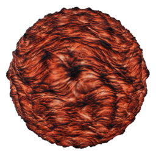</a> <b><a href="Lava005">Lava 005</a></b> by ambientCG · <a href="https://ambientcg.com/a/Lava005">source</a> | <a href="Leaf001">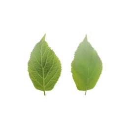</a> <b><a href="Leaf001">Leaf 001</a></b> by ambientCG · <a href="https://ambientcg.com/a/Leaf001">source</a> | <a href="Leaf002">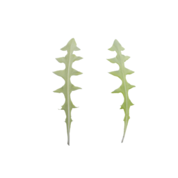</a> <b><a href="Leaf002">Leaf 002</a></b> by ambientCG · <a href="https://ambientcg.com/a/Leaf002">source</a> | <a href="Leaf003">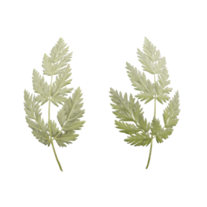</a> <b><a href="Leaf003">Leaf 003</a></b> by ambientCG · <a href="https://ambientcg.com/a/Leaf003">source</a> |
| <a href="Logs001">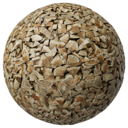</a> <b><a href="Logs001">Logs 001</a></b> by ambientCG · <a href="https://ambientcg.com/a/Logs001">source</a> | <a href="Moss001">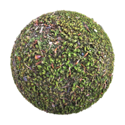</a> <b><a href="Moss001">Moss 001</a></b> by ambientCG · <a href="https://ambientcg.com/a/Moss001">source</a> | <a href="Moss002">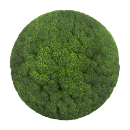</a> <b><a href="Moss002">Moss 002</a></b> by ambientCG · <a href="https://ambientcg.com/a/Moss002">source</a> | <a href="Moss003">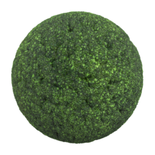</a> <b><a href="Moss003">Moss 003</a></b> by ambientCG · <a href="https://ambientcg.com/a/Moss003">source</a> |
| <a href="Moss004">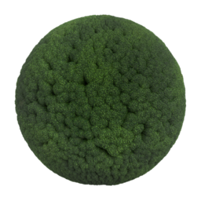</a> <b><a href="Moss004">Moss 004</a></b> by ambientCG · <a href="https://ambientcg.com/a/Moss004">source</a> | <a href="Net001A">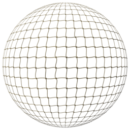</a> <b><a href="Net001A">Net 001 A</a></b> by ambientCG · <a href="https://ambientcg.com/a/Net001A">source</a> | <a href="Net001B">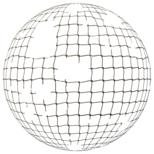</a> <b><a href="Net001B">Net 001 B</a></b> by ambientCG · <a href="https://ambientcg.com/a/Net001B">source</a> | <a href="Net002A">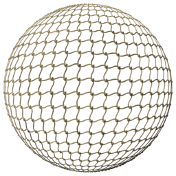</a> <b><a href="Net002A">Net 002 A</a></b> by ambientCG · <a href="https://ambientcg.com/a/Net002A">source</a> |
| <a href="Net002B">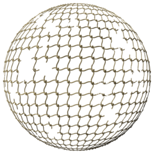</a> <b><a href="Net002B">Net 002 B</a></b> by ambientCG · <a href="https://ambientcg.com/a/Net002B">source</a> | <a href="Net003A">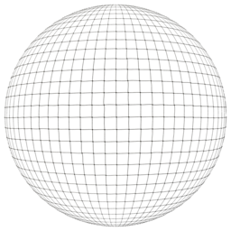</a> <b><a href="Net003A">Net 003 A</a></b> by ambientCG · <a href="https://ambientcg.com/a/Net003A">source</a> | <a href="Net003B">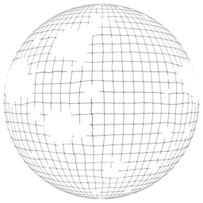</a> <b><a href="Net003B">Net 003 B</a></b> by ambientCG · <a href="https://ambientcg.com/a/Net003B">source</a> | <a href="Net004A">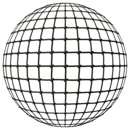</a> <b><a href="Net004A">Net 004 A</a></b> by ambientCG · <a href="https://ambientcg.com/a/Net004A">source</a> |
| <a href="Net004B">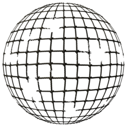</a> <b><a href="Net004B">Net 004 B</a></b> by ambientCG · <a href="https://ambientcg.com/a/Net004B">source</a> | <a href="OfficeCeiling001">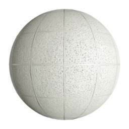</a> <b><a href="OfficeCeiling001">Office Ceiling 001</a></b> by ambientCG · <a href="https://ambientcg.com/a/OfficeCeiling001">source</a> | <a href="OfficeCeiling002">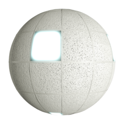</a> <b><a href="OfficeCeiling002">Office Ceiling 002</a></b> by ambientCG · <a href="https://ambientcg.com/a/OfficeCeiling002">source</a> | <a href="OfficeCeiling003">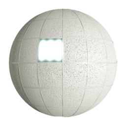</a> <b><a href="OfficeCeiling003">Office Ceiling 003</a></b> by ambientCG · <a href="https://ambientcg.com/a/OfficeCeiling003">source</a> |
| <a href="OfficeCeiling004">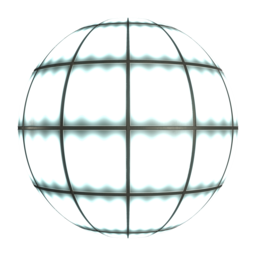</a> <b><a href="OfficeCeiling004">Office Ceiling 004</a></b> by ambientCG · <a href="https://ambientcg.com/a/OfficeCeiling004">source</a> | <a href="OfficeCeiling005">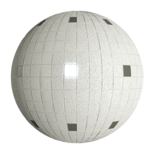</a> <b><a href="OfficeCeiling005">Office Ceiling 005</a></b> by ambientCG · <a href="https://ambientcg.com/a/OfficeCeiling005">source</a> | <a href="OfficeCeiling006">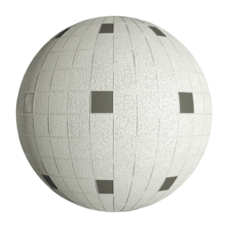</a> <b><a href="OfficeCeiling006">Office Ceiling 006</a></b> by ambientCG · <a href="https://ambientcg.com/a/OfficeCeiling006">source</a> | <a href="Onyx001">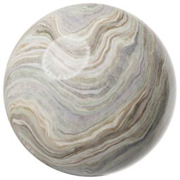</a> <b><a href="Onyx001">Onyx 001</a></b> by ambientCG · <a href="https://ambientcg.com/a/Onyx001">source</a> |
| <a href="Onyx002">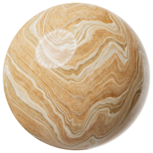</a> <b><a href="Onyx002">Onyx 002</a></b> by ambientCG · <a href="https://ambientcg.com/a/Onyx002">source</a> | <a href="Onyx003">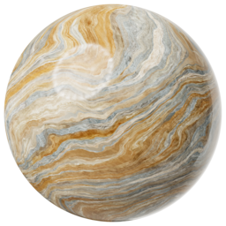</a> <b><a href="Onyx003">Onyx 003</a></b> by ambientCG · <a href="https://ambientcg.com/a/Onyx003">source</a> | <a href="Onyx004">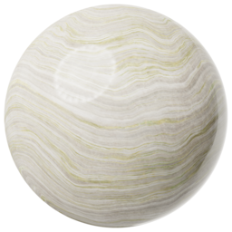</a> <b><a href="Onyx004">Onyx 004</a></b> by ambientCG · <a href="https://ambientcg.com/a/Onyx004">source</a> | <a href="Onyx005">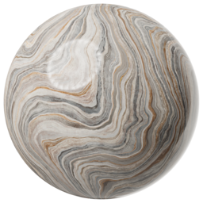</a> <b><a href="Onyx005">Onyx 005</a></b> by ambientCG · <a href="https://ambientcg.com/a/Onyx005">source</a> |
| <a href="Onyx006">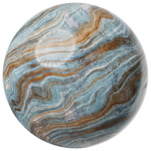</a> <b><a href="Onyx006">Onyx 006</a></b> by ambientCG · <a href="https://ambientcg.com/a/Onyx006">source</a> | <a href="Onyx007">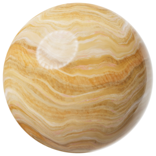</a> <b><a href="Onyx007">Onyx 007</a></b> by ambientCG · <a href="https://ambientcg.com/a/Onyx007">source</a> | <a href="Onyx008">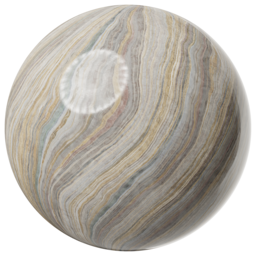</a> <b><a href="Onyx008">Onyx 008</a></b> by ambientCG · <a href="https://ambientcg.com/a/Onyx008">source</a> | <a href="Onyx009">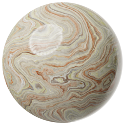</a> <b><a href="Onyx009">Onyx 009</a></b> by ambientCG · <a href="https://ambientcg.com/a/Onyx009">source</a> |
| <a href="Onyx010">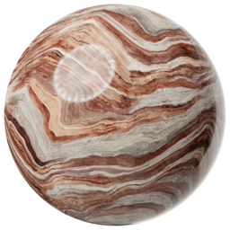</a> <b><a href="Onyx010">Onyx 010</a></b> by ambientCG · <a href="https://ambientcg.com/a/Onyx010">source</a> | <a href="Onyx011">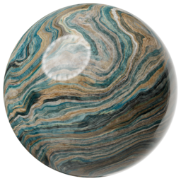</a> <b><a href="Onyx011">Onyx 011</a></b> by ambientCG · <a href="https://ambientcg.com/a/Onyx011">source</a> | <a href="Onyx012">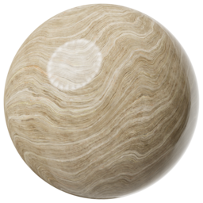</a> <b><a href="Onyx012">Onyx 012</a></b> by ambientCG · <a href="https://ambientcg.com/a/Onyx012">source</a> | <a href="Onyx013">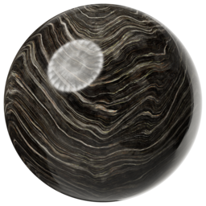</a> <b><a href="Onyx013">Onyx 013</a></b> by ambientCG · <a href="https://ambientcg.com/a/Onyx013">source</a> |
| <a href="Onyx014">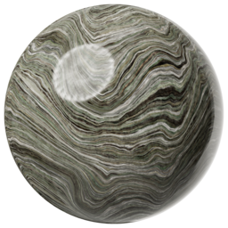</a> <b><a href="Onyx014">Onyx 014</a></b> by ambientCG · <a href="https://ambientcg.com/a/Onyx014">source</a> |  |  |  |

---

Kept up to date by this repository's own [update workflow](.github/workflows/update.yml), with code and plan from [cc0-mirror](https://github.com/zuujis-cc0/cc0-mirror). Something wrong? [Open an issue there](https://github.com/zuujis-cc0/cc0-mirror/issues/new) or use the [private report form](https://games.zuujis.com/report).
